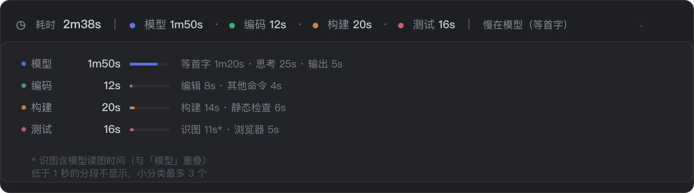

# dsh-turn-timing

English | [简体中文](README.md)

> Package: `@skyrocks/dsh-turn-timing` (GitHub repo: `dsh-turn-timing`)

Shows where each turn went, right under the turn in **DeepSeek Harness**:
**model · coding · build · test · cleanup**. No tab switching, no trajectory digging,
and no extra model call.


<p align="center">
  
</p>

<p align="center">
  
</p>

> Mockups. Real rendering follows your DSH theme (light / dark).

---

## Why

- **See what is slow at a glance**: one line per turn, five segments plus a verdict
  (`slow in test (vision)`).
- **Zero tokens**: computed from session events the browser already received.
  No host request, no log write, nothing enters the model context.
- **Vision is split out**: the screenshot itself takes 0.06s; the expensive part is
  the model call that reads it. It is attributed to *test / vision* instead of hiding
  inside *model*.

---

## Requirements

| Item | Requirement |
| --- | --- |
| DSH | `>=0.2.1-rc.2 <0.3.0` |
| Node | `>=18` |
| Runtime deps | none (React comes from the host) |

---

## Install

1. Sidebar **Plugins** → **Add plugin**
2. Paste `github:skyrocks/dsh-turn-timing` (or an absolute local path)
3. Click **Enable now**
4. Fully quit and reopen the app (client plugins load at startup)

---

## What it shows

Collapsed, under each turn — three groups split by faint rules:

```
◷ 耗时 2m38s  |  ● 模型 1m50s · ● 编码 12s · ● 构建 20s · ● 测试 16s  |  慢在模型（等首字）
```

Click to expand sub-categories (each with a share bar):

```
  模型    1m50s   ███████░░░░   first token 1m20s · thinking 25s · output 5s
  编码      12s   █░░░░░░░░░░   edit 8s · other 4s
  构建      20s   █░░░░░░░░░░   build 14s · lint 6s
  测试      16s   █░░░░░░░░░░   vision 11s* · browser 5s
```

- Fixed order: **model → coding → build → test → cleanup**; a category with no data is omitted.
- Segments under 1s are hidden; at most 3 sub-categories, longest first.
- `*` marks vision, which overlaps the model row — see below.
- Only model and tool time is counted. Waiting for the user or for approval is excluded.

---

## How numbers are computed

| Row | Source |
| --- | --- |
| model | `step/start` → `assistant/message` wall clock, summed over calls |
| first token | request sent → first streamed chunk (TTFT) |
| thinking | span of reasoning deltas |
| output | span of text deltas |
| vision | the whole model call that follows `read_image` |
| everything else | `tool/call` → `tool/result` wall clock |

**Vision counts as model time** on purpose: the tool itself is nearly instant
(0.06s median), the model re-reading the image is not (17s median locally).
Rows carry a `*` to mark the overlap.

**Tool calls pair most-recent-first.** Forked or replayed sessions repeat the same
`callId`; a plain dictionary lookup pairs with a stale record and reports
"one read took 25 hours". Pairs longer than one hour are dropped.

---

## Classification

First match wins. Edit the `RULES` array at the top of `client.js` to change it.

| Priority | Category | Matches (excerpt) |
| --- | --- | --- |
| 1 | test / command | `pytest`, `vitest`, `jest`, `go test`, `mvn … test\|verify` |
| 2 | test / browser | `playwright`, `puppeteer`, `selenium`, `cypress` |
| 3 | build / build | `tsc`, `vite build`, `mvn … compile`, `docker build` |
| 4 | build / install | `pnpm install`, `npm ci`, `pip install` |
| 5 | build / lint | `eslint`, `ruff`, `mypy`, `tsc --noEmit` |
| 6 | cleanup / restore | `git checkout --`, `git restore`, `make clean` |
| 7 | cleanup / temp files | `rm … /tmp/…`, `rm … *.log` |
| 8 | cleanup / processes | `kill`, `pkill`, `killall` |
| 9 | coding / edit | `sed -i`, `cat > file`, `edit` / `write` tools |
| 10 | coding / read | `read` tool |
| 11 | coding / search | `grep` / `glob` tools |

**Deliberately excluded**: waiting for the user, waiting for approval. Neither is
model time nor tool time; mixing them in would distort the "what is slow" answer.

---

## Limitations

- Only turns whose `step/start` is in the loaded window are shown; no estimation.
- A single `bash` call has one wall clock; per-test-case timings are not visible.
- Classification is regex based: a test command hidden inside `./run.sh` stays "other".

---

## Development

```sh
node test/smoke.mjs
```

MIT licensed.
