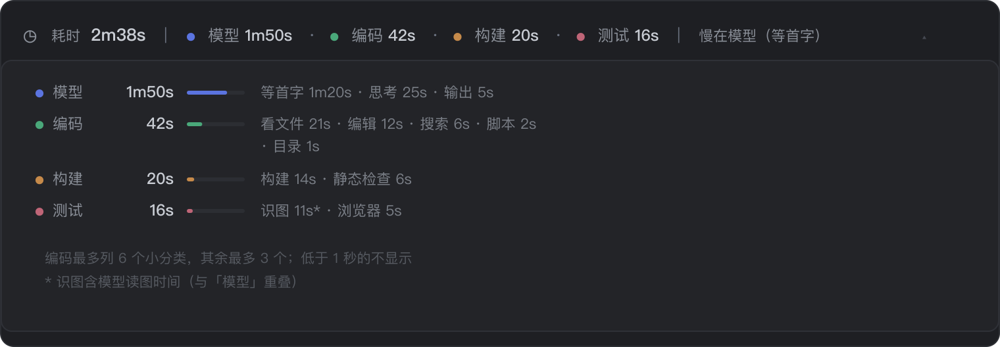

# dsh-turn-timing

[English](README.en.md) | 简体中文

> 包名：`@skyrocks/dsh-turn-timing`（GitHub 仓库名：`dsh-turn-timing`）

在 **DeepSeek Harness** 的每一轮对话末尾，直接显示这一轮的时间花在哪：
**模型 · 编码 · 构建 · 测试 · 清理**。不用切页签，不用翻轨迹页，也不花一次模型调用。


<p align="center">
  
</p>

<p align="center">
  
</p>

> 以上为界面示意图，实际样式跟随 DSH 主题（明 / 暗）。

---

## 为什么用它

- **一眼看到慢在哪**：每轮结尾一行，五个分段 + 一句结论（`慢在测试（识图）`）。
- **零 token**：数据来自浏览器已经收到的会话事件，不请求宿主、不写日志、不进模型上下文。
- **识图单独拆出来**：截图本身只要 0.06 秒，慢的是之后那次模型读图调用——它被算进「测试 / 识图」，不再藏在「模型」里。
- **和内置统计页签互补**：内置「统计」是表格页签，要主动切过去看；这里是每轮自动出现的一行。

---

## 环境要求

| 项 | 要求 |
| --- | --- |
| DSH | `>=0.2.1-rc.2 <0.3.0` |
| Node | `>=18` |
| 运行时依赖 | 无（只用 React，由宿主提供） |

---

## 安装

### 方式一：插件页安装（推荐）

1. 侧栏 **插件** → **添加插件**
2. 粘贴 `github:skyrocks/dsh-turn-timing`
3. 安装完成后点 **立即启用**
4. 完全退出 App 再打开（客户端插件在启动时装载）

### 方式二：从本地目录装

1. 侧栏 **插件** → **添加插件**
2. 粘贴本地绝对路径，例如 `/Users/you/code/dsh-turn-timing`
3. 同样「立即启用」+ 完全退出重启

### 方式三：手工挂到 profile

在 `~/.dsh/profiles/<profile>/package.json` 里加依赖与 bundle：

```json
{
  "dsh": { "profile": { "bundles": ["...", "@skyrocks/dsh-turn-timing"] } },
  "dependencies": { "@skyrocks/dsh-turn-timing": "link:/path/to/dsh-turn-timing" }
}
```

然后在该目录执行 `pnpm install`，重启 App。

---

## 显示什么

每轮末尾一行（折叠态），三段用淡竖线分开：

```
◷ 耗时 2m38s  |  ● 模型 1m50s · ● 编码 12s · ● 构建 20s · ● 测试 16s  |  慢在模型（等首字）
```

点一下展开小分类（每类带占比条）：

```
  模型    1m50s   ███████░░░░   等首字 1m20s · 思考 25s · 输出 5s
  编码      42s   █░░░░░░░░░░   看文件 21s · 编辑 12s · 搜索 6s · 脚本 2s
                                 · 目录 1s
  构建      20s   █░░░░░░░░░░   构建 14s · 静态检查 6s
  测试      16s   █░░░░░░░░░░   识图 11s* · 浏览器 5s
```

- 五类固定顺序：**模型 → 编码 → 构建 → 测试 → 清理**，没有数据的那一类整行不出现。
- 低于 1 秒的分段不显示。「编码」最多列 6 个小分类，其余分类最多 3 个（按耗时倒序），放不下自动换行。
- 带 `*` 的「识图」是模型读图调用，和「模型」有重叠，见下面的口径说明。
- 只统计模型与工具；**等你回答、等你审批不计入**，混进来会让「慢」失真。

---

## 口径

| 行 / 小分类 | 怎么来的 |
| --- | --- |
| 模型 | `step/start` → `assistant/message` 的墙钟，按全部调用累加 |
| 等首字 | 请求发出 → 流里第一个 chunk（TTFT） |
| 思考 | reasoning delta 的起止区间 |
| 输出 | text delta 的起止区间 |
| 识图 | `read_image` 之后那次模型调用的整段时长 |
| 其余各行 | `tool/call` → `tool/result` 的墙钟 |

**为什么识图算模型时间**：截图工具本身几乎是瞬时（本机中位 0.06 秒），
真正耗时的是模型重新读图的那一次调用（中位 17 秒）。只按工具名统计的话，
识图会被显示成 0.06 秒——所以这里把它挂到「测试」，并标 `*` 说明与「模型」重叠。

**为什么工具调用要按顺序配对**：fork / 重放会让同一个 `callId` 在日志里出现多次。
按字典查会配到很久以前的旧记录，算出「一次 read 用了 25 小时」这种假数。
本插件配最近的那次，并直接丢弃超过 1 小时的配对。

---

## 分类规则

按顺序匹配，**第一个命中的赢**：

| 优先级 | 分类 / 小分类 | 命中条件（节选） |
| --- | --- | --- |
| 1 | 测试 / 命令测试 | `pytest`、`vitest`、`jest`、`go test`、`mvn … test\|verify`、`gradle … test\|check` |
| 2 | 测试 / 浏览器 | `playwright`、`puppeteer`、`selenium`、`cypress` |
| 3 | 构建 / 构建 | `tsc`、`vite build`、`webpack`、`mvn … compile\|package`、`docker build` |
| 4 | 构建 / 安装 | `pnpm install`、`npm ci`、`pip install`、`brew install` |
| 5 | 构建 / 静态检查 | `eslint`、`ruff`、`mypy`、`tsc --noEmit` |
| 6 | 清理 / 还原 | `git checkout --`、`git restore`、`git stash`、`docker stop`、`make clean` |
| 7 | 清理 / 临时文件 | `rm … /tmp/…`、`rm … *.log` |
| 8 | 清理 / 进程 | `kill`、`pkill`、`killall` |
| 9 | 编码 / 编辑 | `sed -i`、`cat > file`、`tee`、`git apply`，以及 `edit` / `write` 工具 |
| 10 | 编码 / git | `git status / diff / log / add / commit / branch / remote` |
| 11 | 编码 / 搜索 | `rg`、`grep`、`find`，以及 `grep` / `glob` 工具 |
| 12 | 编码 / 看文件 | `cat`、`head`、`tail`、`wc`、`tree`，以及 `read` 工具 |
| 13 | 编码 / 脚本 | `node`、`python3`、`bash`、`tsx`、`npx` |
| 14 | 编码 / 目录 | `cd`、`pwd`、`ls`、`mkdir`、`du` |
| — | 编码 / 其他命令 | 其余一切 |

改口径只需改 `client.js` 顶部的 `RULES` 数组（改完重启 App）：

```js
["测试", "命令测试", /\b(pytest|vitest|jest|…)\b/i],
```

**故意不统计**：等你回答、等你审批。它们既不是模型也不是工具，
混进任何一类都会让「慢」失真；需要的话看会话的「统计」页签。

---

## 已知限制

- **只看当前窗口**：轮次的 `step/start` 不在已加载窗口里时，该轮不显示（不估算）。
- **工具内部不拆**：一次 `bash` 只有一个墙钟；`pytest` 内部哪条用例慢，这里看不到。
- **识图与模型重叠**：这是设计如此，不是 bug。
- **分类靠正则**：`cat package.json | grep test` 这类会被算成「其他命令」，不会误判成测试；但反过来，把测试命令包在脚本里跑（`./run.sh`）就识别不出来。

---

## 和内置「统计」页签的区别

| | 本插件 | 内置 `dsh-client-ui-stats` |
| --- | --- | --- |
| 位置 | 每轮对话末尾，自动出现 | 独立页签，要切过去 |
| 粒度 | 五个分段 + 小分类 | 每步的上下文 / 缓存 / TTFT / 输出速度 |
| 成本 | 0 token | 0 token |
| 适合 | 快速判断「这轮慢在哪」 | 逐步骤做性能分析 |

---

## 开发

```sh
node test/smoke.mjs     # 纯计算冒烟测试，不开浏览器
```

目录：

| 文件 | 职责 |
| --- | --- |
| `client.js` | 浏览器半：事件折叠、分类、格式化、渲染 |
| `index.js` | 宿主半：空的 `apply`，只为占一条 Loader 行 |
| `cordis.patch.yml` | 声明自己是 bundle，安装时自动注入 profile |
| `test/smoke.mjs` | 折叠与归类的回归测试 |

---

## 许可

MIT
